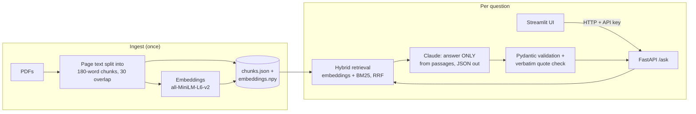

# Private markets RAG assistant

A retrieval-augmented question-answering service over private-markets documents. It answers
only from the source documents, quotes its sources word for word, and says "not found" when
the documents don't answer. An evaluation harness scores every change, so improvements are
measured rather than guessed.

**Corpus (5 public documents, 1,349 chunks):** IPEV Valuation Guidelines (2025), ILPA
Principles 3.0, ILPA Reporting Template Definitions, ILPA Template FAQs v1.1, 3i Group
Annual Report FY2026.

> Status: working prototype, not production. See [What I would change for production](#what-i-would-change-for-production).

## Results

Evaluated on 28 hand-written test cases: 18 answerable, 5 multi-passage, 5 deliberately
unanswerable.

| Configuration | Retrieval hit rate | Answers correct | Refusals correct | Quotes verbatim |
|---|---|---|---|---|
| Baseline: 350-word chunks, embeddings, top 4 | 70% | 70% | 5/5 | 72/72 |
| 180-word chunks, embeddings, top 4 | 74% | | | |
| 180-word chunks, BM25 keyword search, top 4 | 78% | | | |
| 180-word chunks, embeddings, top 8 | 91% | | | |
| **180-word chunks, hybrid (RRF), top 4** | **96%** | **96%** | **5/5** | **70/70** |

Answer metrics come from full runs (baseline and final). The retrieval-only rows are
free runs used to choose between settings, changing one setting at a time.

**Takeaway:** hybrid search at top 4 beats pure embeddings at top 8, with half as many
passages in the prompt (less noise, lower cost per question). The misses show why:
embeddings miss exact-term questions ("placement fees", fee-offset percentages), BM25
misses paraphrased ones, and fusion covers both. The one remaining miss is a two-part
question whose second fact sits on a different page.

## How it works



1. **Ingest** ([rag/ingest.py](rag/ingest.py)): extract text per page, split into overlapping
   180-word chunks tagged with document and page, embed each chunk. Chunks are kept under
   the embedding model's 256-token limit, which silently truncates longer input.
2. **Retrieve** ([rag/retrieve.py](rag/retrieve.py)): score every chunk with embeddings
   (cosine similarity) and BM25 (keyword), then combine with **reciprocal rank fusion**:
   `score = Σ 1 / (60 + rank)`. RRF uses ranks, not raw scores, because cosine (0–1) and
   BM25 (unbounded, varies per query) are on different scales.
3. **Answer** ([rag/answer.py](rag/answer.py)): Claude is told to answer only from the
   numbered passages and reply in JSON with quotes. Pydantic validates the structure (a
   malformed reply becomes a safe "not found"), and code checks each quote really appears
   in the passage it cites.
4. **Serve** ([api/main.py](api/main.py)): FastAPI `POST /ask` and `GET /health`. The index
   and models load once at startup; an `X-API-Key` header is required (fail closed,
   timing-safe comparison); Claude outages return 503; each request logs latency, outcome
   and citation counts.
5. **UI** ([ui/app.py](ui/app.py)): Streamlit page that calls the API over HTTP only, never
   the Python code, so the API is the contract and the UI is just one client. It shows
   the answer or "not found", the quotes with document and page, and every retrieved
   passage with its score.

## Architectural decisions

Each choice, what it was chosen over, and what it costs. "Measured" means the eval harness
decided it; the rest are judgement calls for a prototype at this scale.

| Decision | Instead of | Why | Cost of this choice |
|---|---|---|---|
| **Hybrid retrieval, fused with RRF** | Embeddings only; BM25 only; adding normalised scores | Measured: 96% vs 74% / 78% at top 4. RRF combines ranks, so no score normalisation or tuning is needed | Two indexes to build and keep in sync; equal weighting can let a weak retriever pull a good passage down |
| **Small top-k (4), better ranking** | A larger k (8 got 91% with embeddings alone) | Fewer passages means less noise for the model and lower cost per question | Little margin: a relevant passage ranked 5th is lost; a reranker would add margin |
| **180-word chunks within a page, 30-word overlap** | Larger chunks; chunks spanning pages; semantic chunking | Fits the embedding model's 256-token limit; keeping page boundaries makes every citation point to one page | A fact split across a page break can't be retrieved whole; more chunks to score |
| **Local embedding model** (all-MiniLM-L6-v2) | A hosted embedding API | Free, runs on a laptop CPU, and document text never leaves the machine at ingest | Weaker than larger models; 256-token input limit |
| **Flat files + in-memory NumPy search** | A vector database | 1,349 chunks score in milliseconds by brute force; no infrastructure to run | Index loaded per process, rebuilt from scratch on change, doesn't scale to millions of chunks |
| **JSON output, Pydantic validation, code-checked quotes** | Free-text answers | Every citation is machine-checkable; a malformed reply becomes a safe "not found" (fail safe) | Proves a quote exists, not that it supports the claim |
| **Refusal decided by the model** | A retrieval score threshold | Fused RRF scores aren't calibrated similarities, so a fixed cut-off would be arbitrary | Every off-topic question still costs a model call |
| **API as the only boundary; UI calls it over HTTP** | Streamlit importing the RAG code directly | Any client (UI, Slack bot, another system) uses one contract; auth, logging and errors live in one place; front and back end deploy separately | Two processes and a network hop |
| **Synchronous endpoint in FastAPI's thread pool** | `async def` endpoint | The embedding model and Claude client calls block; inside `async def` they would stall every other request | Concurrency limited by thread-pool size; an async client would scale further |
| **Load index and models at startup** | Lazy loading on first request | Predictable latency from the first request; `/health` reflects real readiness | Slower startup; each worker process holds its own copy in memory |
| **One shared API key, fail closed** | No auth; per-user OAuth | Real protection with minimal setup; a missing key means "deny", never "allow" | No per-user identity, so no per-user access control or audit trail |
| **All settings in one file, saved with every eval run** | Settings scattered in code | Each result is reproducible and comparable; one setting changed per experiment | None worth noting, and it caught a mislabelled run |

## Evaluation

[eval/run_eval.py](eval/run_eval.py) runs [eval/test_set.json](eval/test_set.json) and saves
each run with the exact config used. [eval/compare.py](eval/compare.py) prints all runs side by side.

| Metric | How it is measured |
|---|---|
| Retrieval hit rate | Every expected fact appears in the retrieved passages (exact phrase; a fact can list alternative phrasings when the documents repeat it) |
| Answer correctness | LLM judge compares the answer with a reference answer: correct / partial / incorrect |
| Refusal accuracy | Unanswerable questions must return `found: false` |
| Quotes verbatim | Deterministic code check: each quote is in the chunk it cites |

`--no-llm` runs retrieval only, which is free and takes seconds, so retrieval settings can
be compared cheaply before spending on full runs.

## Three things that went wrong, and what I learned

**1. The metric was wrong, not the system.** A full run showed 96% correct answers but only
74% retrieval hits, which can't both be right. The citation check only accepts quotes from
retrieved passages, so the facts must have been retrieved. The cause: each expected phrase
pinned the test to *one* passage, but these documents repeat facts (3i's NAV per share
appears on three pages). Retrieving a different page that states the same fact counted as a
miss. I let a fact list alternative phrasings, each copied from a passage that actually
states it, and re-ran every configuration. The ranking of configurations didn't change; the
absolute numbers did (hybrid 74% → 96%). *Lesson: when two metrics disagree, suspect the
metric first.*

**2. A verbatim quote proves the text exists, not that it supports the claim.** For "What
was 3i's total return?" the answer was right, and the quote passed the verbatim check, but
the quote also contained an unrelated figure (84.5p, the dividend) because PDF extraction had
merged two KPI boxes into one line. A deterministic check catches invented quotes; it can't
catch a real quote used as evidence for the wrong thing. Production systems add a second check
(a model or a person) for support.

**3. Smaller chunks helped less than expected.** The embedding model reads at most 256
tokens, so with 350-word chunks only the first half of each chunk counted. Halving chunk size
fixed exactly one question (70% → 74%). The bigger problem was **crowding**: the right
passage ranked 5th–8th behind similar-looking ones, which top-8 and then hybrid search
addressed. *Lesson: a correct diagnosis can still be a minor cause; measure before assuming.*

## Known limits

- **Small test set** (28 cases, written by me). Good for comparing settings, too small for
  confident absolute numbers. Some alternative phrasings were added after seeing results,
  which carries some risk of bias. They also raised the other configurations, so the
  comparison stands.
- **The judge is the same model as the answerer.** Self-grading can be lenient; a different
  judge model and hand-checked samples would be more trustworthy.
- **Equal-weight fusion.** RRF trusts both retrievers equally; on a query where one is
  guessing (common words like "fair value" in a valuation guideline) it can pull a good
  passage down.
- **"Found" is yes/no.** Some questions are partly answerable; a "partial" outcome would be
  more honest.
- **No OCR.** Image-only pages (one in the 3i report) and tables are not searchable.
- **Retrieval always returns k passages**, even when none are relevant; refusal relies on the
  model.
- **Flat-file index in memory, one process.** Fine for 1,349 chunks, not for millions.

## What I would change for production

| Area | Change |
|---|---|
| Storage | Move vectors to a database with vector search (e.g. Postgres + pgvector) so the index is shared, updated incrementally and not reloaded per process |
| Retrieval quality | Cross-encoder reranker over the top ~20; query decomposition for multi-part questions; weighted RRF; a relevance threshold to refuse before calling the model |
| Ingestion | OCR and table extraction; fix PDF artefacts (split words, merged boxes); drop front matter; re-ingest on document change |
| Evaluation | Run the eval in CI on every change and block regressions; larger test set built with domain experts; separate judge model; sample human review |
| Monitoring | Dashboards for latency, refusal rate, citation validity and cost per question; alert on drift; collect user feedback on answers |
| Cost and latency | Prompt caching for the fixed instructions; a smaller model for easy questions; async client and streaming answers |
| Security | Secrets in a secrets manager, not environment files; per-user auth instead of one shared key; document-level access control so users only retrieve what they may see; rate limiting |
| Privacy | Decide whether question text may be logged; redact or hash it if not |
| Operations | Docker image with the embedding model baked in (no download at startup); health and readiness checks; horizontal scaling behind a load balancer |

## Run it

Requires Python 3.12 and an Anthropic API key.

```bash
python -m venv .venv && source .venv/bin/activate
pip install -r requirements.txt
```

**Documents:** the PDFs are not in the repo. Download the five public documents listed at the
top from their publishers' websites into `docs/`, then build the index:

```bash
python -m rag.ingest
```

**Command line:**

```bash
read -s "ANTHROPIC_API_KEY?Anthropic key: "; export ANTHROPIC_API_KEY; echo   # zsh; hidden input
python -m rag.retrieve "What is the definition of fair value?"   # retrieval only, free
python -m rag.answer "What is the definition of fair value?"
python -m eval.run_eval --no-llm --label my-run                  # retrieval metrics, free
python -m eval.run_eval --label my-run                           # full evaluation, uses the API
python -m eval.compare
```

**API and UI** (two terminals; `.env` is git-ignored):

```bash
python -c "import secrets; print('export RAG_API_KEY=' + secrets.token_urlsafe(32))" > .env

# Terminal 1 (also needs ANTHROPIC_API_KEY set)
source .env && uvicorn api.main:app --reload      # API docs: http://127.0.0.1:8000/docs

# Terminal 2
source .env && streamlit run ui/app.py            # UI: http://localhost:8501
```

Settings (chunk size, overlap, top-k, retrieval mode) live in [rag/config.py](rag/config.py);
the model is set with the `RAG_MODEL` environment variable.

## Project layout

```
rag/      config.py, ingest.py, retrieve.py (hybrid RRF), answer.py
api/      main.py - FastAPI service
ui/       app.py - Streamlit front end
eval/     test_set.json, run_eval.py, compare.py
notes.md  experiment log: every finding, including the wrong turns
```
